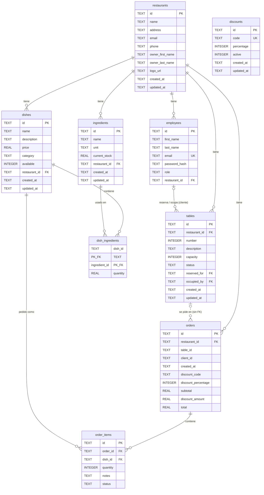

# Modelo de Datos

Esquema de la base de datos SQLite de Resttek.

---

## Diagrama Entidad-Relación

---

## Tablas

### `restaurants`

Almacena la información de los restaurantes.

| Columna | Tipo | Nullable | Descripción |
| --- | --- | --- | --- |
| `id` | TEXT | No | UUID, clave primaria |
| `name` | TEXT | No | Nombre del restaurante |
| `address` | TEXT | No | Dirección |
| `email` | TEXT | No | Email de contacto |
| `phone` | TEXT | No | Teléfono |
| `owner_first_name` | TEXT | No | Nombre del propietario |
| `owner_last_name` | TEXT | No | Apellido del propietario |
| `logo_url` | TEXT | Sí | URL del logo |
| `created_at` | TEXT | No | Fecha de creación (ISO 8601) |
| `updated_at` | TEXT | No | Fecha de última actualización |

---

### `employees`

Almacena **todos** los usuarios del sistema, incluidos los clientes: no hay tabla de clientes aparte. Un cliente es una fila con `role = 'cliente'` y `restaurant_id` a null.

| Columna | Tipo | Nullable | Descripción |
| --- | --- | --- | --- |
| `id` | TEXT | No | UUID, clave primaria |
| `first_name` | TEXT | No | Nombre |
| `last_name` | TEXT | No | Apellido |
| `email` | TEXT | No | Email (único) |
| `password_hash` | TEXT | No | Hash bcrypt de la contraseña |
| `role` | TEXT | No | Rol: admin, manager, camarero, cocinero, cliente |
| `restaurant_id` | TEXT | Sí | FK → `restaurants.id` (null para admin y cliente) |

**Restricciones:**

- `email` es UNIQUE.
- `restaurant_id` es FK a `restaurants.id`.

---

### `ingredients`

Ingredientes disponibles en cada restaurante.

| Columna | Tipo | Nullable | Descripción |
| --- | --- | --- | --- |
| `id` | TEXT | No | UUID, clave primaria |
| `name` | TEXT | No | Nombre del ingrediente |
| `unit` | TEXT | No | Unidad: kg, g, l, ml, unidad |
| `current_stock` | REAL | No | Stock actual (default: 0) |
| `restaurant_id` | TEXT | No | FK → `restaurants.id` |
| `created_at` | TEXT | No | Fecha de creación |
| `updated_at` | TEXT | No | Fecha de última actualización |

---

### `dishes`

Platos de la carta de cada restaurante.

| Columna | Tipo | Nullable | Descripción |
| --- | --- | --- | --- |
| `id` | TEXT | No | UUID, clave primaria |
| `name` | TEXT | No | Nombre del plato |
| `description` | TEXT | Sí | Descripción |
| `price` | REAL | No | Precio en euros |
| `category` | TEXT | No | Categoría: entrante, principal, postre, bebida |
| `available` | INTEGER | No | Disponibilidad: 1 = sí, 0 = no (default: 1) |
| `restaurant_id` | TEXT | No | FK → `restaurants.id` |
| `created_at` | TEXT | No | Fecha de creación |
| `updated_at` | TEXT | No | Fecha de última actualización |

---

### `dish_ingredients`

Relación muchos-a-muchos entre platos e ingredientes.

| Columna | Tipo | Nullable | Descripción |
| --- | --- | --- | --- |
| `dish_id` | TEXT | No | FK → `dishes.id` (PK compuesta) |
| `ingredient_id` | TEXT | No | FK → `ingredients.id` (PK compuesta) |
| `quantity` | REAL | No | Cantidad del ingrediente necesaria |

**Restricciones:**

- PK compuesta: (`dish_id`, `ingredient_id`).
- FK a `dishes.id` **con** `ON DELETE CASCADE`: al borrar un plato desaparecen sus ingredientes asociados.
- FK a `ingredients.id` **sin** cascada.

---

### `orders`

Pedidos de los clientes.

| Columna | Tipo | Nullable | Descripción |
| --- | --- | --- | --- |
| `id` | TEXT | No | UUID, clave primaria |
| `restaurant_id` | TEXT | No | FK → `restaurants.id` |
| `table_id` | TEXT | Sí | Id de la mesa (`tables.id`) desde la que se pide; **sin FK** (opcional) |
| `client_id` | TEXT | Sí | ID del cliente (opcional) |
| `created_at` | TEXT | No | Fecha de creación |
| `discount_code` | TEXT | Sí | Copia del código de descuento aplicado (`null` si no tiene) |
| `discount_percentage` | INTEGER | Sí | Copia del porcentaje aplicado (`null` si no tiene) |
| `subtotal` | REAL | Sí | Subtotal fijado al aplicar el descuento (`null` si no tiene) |
| `discount_amount` | REAL | Sí | Importe descontado fijado al aplicar el descuento (`null` si no tiene) |
| `total` | REAL | Sí | Total con descuento fijado al aplicar el descuento (`null` si no tiene) |

`discount_code` **no** es FK a `discounts`: es una copia (snapshot) tomada al aplicar el código, para que editar, desactivar o borrar el descuento no altere los pedidos existentes. Un pedido tiene como mucho un descuento.

Importes del pedido:

- **Con descuento:** al aplicar el código (`PUT /orders/{id}/discount`) se calculan `subtotal`, `discount_amount` y `total` con los precios de los platos en ese momento (redondeo a 2 decimales) y se guardan. Las lecturas devuelven esos valores, así que cambiar después el precio de un plato no altera el total. Reaplicar el mismo código no los recalcula.
- **Sin descuento:** las tres columnas son `NULL` y los importes se calculan al leer con el precio actual de los platos (`withOrderTotals()` en `models/order.model.ts`). Quitar el descuento vuelve a poner las columnas a `NULL`.
- **Cambios en los ítems:** cambiar el estado de un ítem no afecta a los importes. La API no permite añadir ni modificar platos o cantidades de un pedido existente; si algún día se permite, la regla será recalcular los importes fijados con el mismo `discount_percentage` y los precios del momento del cambio.

En bases de datos creadas antes de existir los descuentos, `initialize()` añade estas cinco columnas con `ALTER TABLE` (`addColumnIfMissing()`) si faltan.

---

### `tables`

Mesas de un restaurante. Las gestiona el `admin`; los empleados cambian su estado y los clientes las ocupan.

| Columna | Tipo | Nullable | Descripción |
| --- | --- | --- | --- |
| `id` | TEXT | No | UUID, clave primaria (el seed usa ids fijos `table-rest-1-1`…) |
| `restaurant_id` | TEXT | No | FK → `restaurants.id` |
| `number` | INTEGER | No | Número visible de la mesa, entero ≥ 1. Único por restaurante (`UNIQUE(restaurant_id, number)`) |
| `description` | TEXT | Sí | Descripción libre (`trim()`; vacía → `NULL`) |
| `capacity` | INTEGER | No | Número máximo de comensales, entero ≥ 1 |
| `status` | TEXT | No | `libre` (por defecto), `ocupada` o `reservada` |
| `reserved_for` | TEXT | Sí | FK → `employees.id` del cliente dueño de la reserva (solo con `reservada`) |
| `occupied_by` | TEXT | Sí | FK → `employees.id` del cliente que ocupó la mesa con `occupy` (solo con `ocupada`) |
| `created_at` | TEXT | No | Fecha de creación |
| `updated_at` | TEXT | No | Fecha de última modificación |

- Las mesas se crean siempre `libre`; el estado solo cambia con `PATCH .../tables/{id}/status` (empleados) o `POST .../tables/{id}/occupy` (cliente).
- Al cambiar a cualquier estado se limpia `occupied_by`; `reserved_for` solo se mantiene con `reservada`.
- La ocupación es un único `UPDATE ... WHERE` condicional (atómico): solo se aplica si la mesa está `libre`, `reservada` para ese cliente u `ocupada` ya por él, y tiene `capacity >=` comensales.
- No se puede borrar una mesa `ocupada`.
- `orders.table_id` no tiene FK a `tables.id`: la tabla `orders` ya existía y hay pedidos sin mesa.

---

### `discounts`

Códigos de descuento globales (no pertenecen a un restaurante). Los gestiona el `admin`.

| Columna | Tipo | Nullable | Descripción |
| --- | --- | --- | --- |
| `id` | TEXT | No | UUID, clave primaria |
| `code` | TEXT | No | Código normalizado (mayúsculas, `^[A-Z0-9_-]{3,30}$`), **único** |
| `percentage` | INTEGER | No | Porcentaje a descontar, entero entre 1 y 100 (`CHECK`) |
| `active` | INTEGER | No | 1 = se puede aplicar, 0 = desactivado. Por defecto 1 |
| `created_at` | TEXT | No | Fecha de creación |
| `updated_at` | TEXT | No | Fecha de última modificación |

---

### `order_items`

Líneas de pedido. Cada ítem es un plato con cantidad y estado.

| Columna | Tipo | Nullable | Descripción |
| --- | --- | --- | --- |
| `id` | TEXT | No | UUID, clave primaria |
| `order_id` | TEXT | No | FK → `orders.id` |
| `dish_id` | TEXT | No | FK → `dishes.id` |
| `quantity` | INTEGER | No | Cantidad pedida |
| `notes` | TEXT | Sí | Notas del cliente (ej: "sin gluten") |
| `status` | TEXT | No | Estado: pendiente, preparando, listo, entregado |

**Restricciones:**

- ON DELETE CASCADE desde `orders.id`.

---

## Relaciones

| Relación | Tipo | Descripción |
| --- | --- | --- |
| Restaurant → Employees | 1:N | Un restaurante tiene muchos empleados |
| Restaurant → Ingredients | 1:N | Un restaurante tiene muchos ingredientes |
| Restaurant → Dishes | 1:N | Un restaurante tiene muchos platos |
| Restaurant → Orders | 1:N | Un restaurante tiene muchos pedidos |
| Restaurant → Tables | 1:N | Un restaurante tiene muchas mesas (número único por restaurante) |
| Table → Orders | 1:N (sin FK) | Un pedido puede guardar la mesa desde la que se hizo (`orders.table_id`) |
| Employee (cliente) → Tables | 1:N | Un cliente puede ser dueño de reservas (`reserved_for`) u ocupante (`occupied_by`) |
| Dish ↔ Ingredient | N:M | Un plato usa varios ingredientes (via `dish_ingredients`) |
| Order → OrderItems | 1:N | Un pedido tiene varios ítems |
| Dish → OrderItems | 1:N | Un plato puede estar en varios ítems de pedido |
| Discount → Orders | 1:N (sin FK) | Un código puede aplicarse a muchos pedidos; cada pedido guarda una copia del código y el porcentaje |

---

## Notas Técnicas

- **IDs**: Todos son UUID v4 generados con `crypto.randomUUID()`. Excepción: el script de seed usa los identificadores fijos `rest-1` y `rest-2` para los restaurantes de prueba y `table-rest-{1|2}-{n}` para sus mesas.
- **Fechas**: Almacenadas como TEXT en formato ISO 8601 (`new Date().toISOString()`).
- **Booleanos**: SQLite no tiene tipo BOOLEAN; se usa INTEGER (0 = false, 1 = true).
- **Nomenclatura**: las columnas son `snake_case` y las propiedades TypeScript `camelCase`. La conversión se hace con alias en el propio SQL (`owner_first_name as ownerFirstName`).
- **Migraciones**: Las tablas se crean automáticamente en `Database.initialize()` con `CREATE TABLE IF NOT EXISTS`.
- **Sin migrations framework**: No se usa un sistema de migraciones formal. Los cambios de esquema se hacen modificando `runInitialMigrations()`. Como solo se ejecuta `CREATE TABLE IF NOT EXISTS`, **añadir una columna no afecta a una base de datos ya creada**: hay que borrar `packages/api/resttek.db` y volver a sembrar.